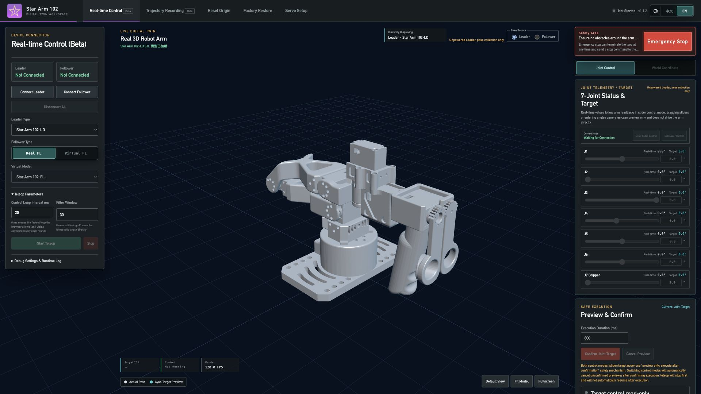

# 开始使用 Star Arm 102

[← 首页](../README.zh.md)　|　[English](getting-started.md) / **简体中文**

本指南默认你的 Star Arm 102 已完成组装。从连接设备开始，体验数字孪生，再进入实体机械臂联动和第一个 AI 任务。只有一台机械臂也可以开始。

> **机械臂尚未组装？** 请先查看 [DIY 装配指南](../hardware/diy-assembly/README.zh.md)，完成后回到这里连接设备。

**目录：**

- [🔌 1. 连接机械臂](#connect)
- [🎮 2. 体验数字孪生](#digital-twin)
- [🦾 3. 让实体机械臂联动](#teleoperation)
- [🤖 4. 运行第一个 AI 任务](#ai-task)
- [📚 进阶与帮助](#next-steps)

## 🔌 1. 连接机械臂

查看型号标签：**LD** 是手动示教主臂，**HD** 是姿态保持主臂，**FL** 是执行从臂。请依据标签判断型号，不要只凭外观区分。

固定底座，准备配套电源、USB 数据线和电脑。更改舵机或电源接线前先断电。每台机械臂使用各自匹配的电源；USB 负责数据通信，不能替代舵机供电。

- **LD／HD + FL：** 参考[硬件接线指南](hardware-setup.md)。将两台机械臂各自的 UC-01 连接电脑，分别识别主臂和从臂端口。
- **LD／HD + 其他品牌：** 在[跨品牌目录](../integrations/)中选择从臂，按对应要求连线。电源与适配器使用该品牌的说明。
- **只有一台机械臂：** 先连接现有设备。主臂可以进入第 2 步体验虚拟从臂；只有 FL 时，先做[通信检查](../python-sdk/README.md#check-communication-without-commanding-motion)。

**完成标志：** 电脑能够识别设备，并且你知道它对应哪个端口。首次通信检查不需要摄像头。

## 🎮 2. 体验数字孪生

### 实体主臂 → 网页虚拟从臂

按网页工具中对应型号的说明连接 LD／HD 主臂。移动主臂，观察虚拟从臂的响应，在连接实体从臂之前熟悉关节运动。

**[打开网页控制指南 →](https://fashionstar.com.hk/wiki/software/robot-arm/web-config-tool/)**

支持的设备、浏览器要求与校准步骤以指南为准。图中为未连接硬件时的界面。

### 网页控制 → 实体从臂

**操作说明待补充。** 此处将说明支持的从臂型号及连接流程。目前可先完成第 1 步中的 FL 通信检查；该检查不会发送运动指令。

## 🦾 3. 让实体机械臂联动

已经有主臂和从臂？从虚拟运动继续到实体跟随。

- **LD／HD + FL：** 使用 [Python 直接遥操作指南](../python-sdk/)。HD 用户还需按其中的说明配置按钮。
- **跨品牌组合：** 按[搭配目录](../integrations/)中对应型号的软件与关节映射流程操作。

发送运动指令前先检查通信。Star Arm 102 应确认七个舵机 ID 均有响应。按所选指南完成参考姿态或校准步骤，再小幅移动主臂，检查从臂方向。Python 直接遥操作脚本会在连接时重置多圈计数，不会执行 LeRobot 校准。不要跨插件版本复制校准文件。

**完成标志：** 从臂按预期方向响应，并且你已了解所选指南中的停止操作。

## 🤖 4. 运行第一个 AI 任务

102-FL 准备好后，配置两台摄像头及指定工作场景，运行提供的 ACT 积木放置策略。无需自行训练该策略。

**[运行 ACT 预训练演示 →](../lerobot/examples/act_pick/README.zh.md)**

按演示指南完成环境配置与校准，先运行一次试验。

## 📚 进阶与帮助

- **采集示范数据与训练：** [LeRobot](../lerobot/README.md)；HD 按钮集成见 [HD／FL 配置](../lerobot/lerobot-stararm102/README.md)。
- **开发 ROS 2 应用：** [ROS 2 Humble](../ros2-humble/README.zh.md)。
- **选择兼容的软件：** [兼容性指南](compatibility.md)。只安装所选流程所需的环境；面向客户的 Python 示例以 Ubuntu 22.04 为目标平台。
- **遇到问题？** 先查看[故障排查](troubleshooting.md)。[提交 Issue](https://github.com/servodevelop/Star-Arm-102/issues/new/choose) 时，请附上型号、运行环境、执行命令和完整报错。
